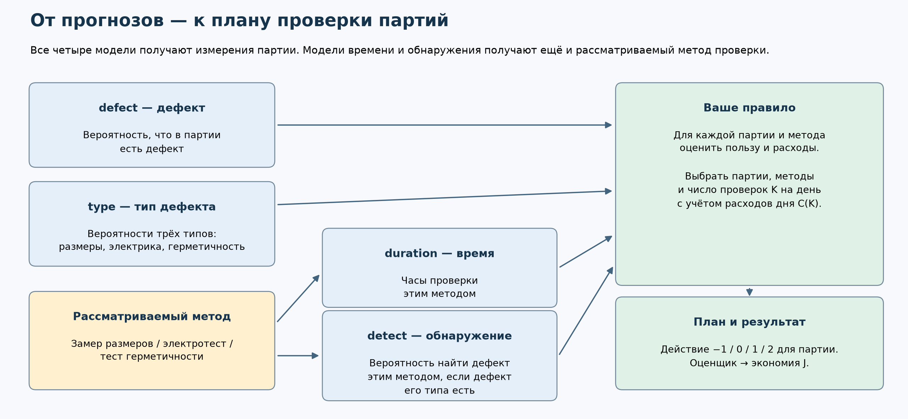

# Практическое задание 3. Какие партии проверить перед отгрузкой?

**Дисциплина «ИИ и машинное обучение»** · НИУ ВШЭ, Высшая школа бизнеса · магистратура «Бизнес-аналитика и цифровые решения в финансах»

## Задача

Вы отвечаете за проверку партий продукции перед отгрузкой. Каждый день к отгрузке готовы 60 партий продукции. В некоторых партиях есть скрытый дефект одного из трёх типов: **размеры**, **электрика** или **герметичность**. Для каждого типа есть свой метод проверки: замер размеров, электротест или тест герметичности. Подходящий метод находит дефект своего типа не всегда; метод для другого типа находит дефект редко.

Если дефект найден, партию дорабатывают и потерь нет. Если дефектную партию отгрузили, предприятие теряет стоимость партии `batch_value_rub`, умноженную на коэффициент потерь типа дефекта (таблица ниже). У герметичности коэффициент самый высокий: такая продукция приводит к отзыву партии.

Лаборатория может проверить не больше 24 партий в день. Каждая проверка стоит денег и времени, а дневная надбавка C(K) (расходы лаборатории за день, которые зависят только от числа проверок K в этот день) растёт быстрее числа проверок. Ваша задача — каждый день решать, какие партии проверять, каким методом и в каком количестве. Число проверок за день мы называем K; оно может меняться по дням, разрешено K=0.

## Модели

Наличие и тип дефекта, длительность проверки и то, найдёт ли метод дефект, заранее неизвестны, но их можно предсказать по измерениям партии. Вам даны готовые модели четырёх задач, по три варианта M1, M2, M3 для каждой задачи — всего 12 моделей.

| Задача | Что предсказывает модель |
|---|---|
| **`defect`** | Вероятность того, что в партии есть дефект |
| **`type`** | Вероятности трёх типов дефекта, если дефект есть |
| **`duration`** | Сколько часов займёт проверка партии выбранным методом |
| **`detect`** | Вероятность того, что выбранный метод найдёт дефект, если в партии есть дефект, соответствующий этому методу |



Модели построены на линейной и логистической регрессии, случайном лесе и градиентном бустинге. Варианты моделей одной задачи различаются алгоритмом и настройками обучения. Карточка модели (`note`) описывает вариант кратко и не полностью, поэтому сравнивайте варианты по метрикам; параметры обучения указаны в `spec["training_parameters"]`. Все студенты получают одинаковые данные и модели.

## Данные

Данные синтетические: их создаёт генератор, имитирующий работу завода. Открытые данные (файлы `validation_*`) — 120 случайно отобранных дней, все 7 200 партий которых прошли полный аудит: каждую такую партию проверили всеми тремя методами, а затем установили истинное наличие и тип дефекта. Поэтому для неё известны наличие и тип дефекта, длительность проверки партии с использованием каждого метода и то, какой метод позволил найти дефект. Закрытый тест — 480 дней, 28 800 партий без ответов; он создан тем же механизмом. Каждая строка — отдельная партия; дни независимы.

Метрики моделей считайте по `validation_labels.csv`. Экономию J правила считает готовый оценщик по `validation_outcomes.csv`: для каждой партии и каждого метода там указаны ожидаемые предотвращённые потери `prevented` и среднее время проверки `hours`, то есть средний результат многократного повторения такой проверки. Это не прогнозы моделей. Используйте этот файл, чтобы оценивать правила и выбирать их общие параметры. Решение, которое по конкретной партии берёт значения из этого файла или из модели, обученной на нём, недопустимо: за экономику ставится 0.

Файлы, поля и функции описаны в **«Справочнике данных и функций»** [шаблона ноутбука](template_quality_control.ipynb).

## Расходы и бизнес-результат

| Метод | Расходные материалы, руб. | Коэффициент потерь (множитель к стоимости партии), если пропущен дефект этого типа |
|---|---:|---:|
| 0 — замер размеров (тип «размеры») | 500 | 1,0 |
| 1 — электротест (тип «электрика») | 1 400 | 1,4 |
| 2 — тест герметичности (тип «герметичность») | 900 | 3,5 |

Час работы лаборатории стоит 1 800 руб. Расходные материалы и работа оплачиваются за каждую проверку, даже если дефекта не было. Дневная надбавка за организацию и сверхурочную работу:

$$
C(K) = 900 \cdot K + 1800 \cdot \max(K - 6,\, 0)^2 \text{ руб.}
$$

Например, C(0)=0, C(6)=5 400, C(12)=75 600, C(24)=604 800 рублей.

Оценщик считает экономию **J** в рублях:

$$
J = \sum_{i \in S}\left(\mathrm{prevented}_i - c_i - 1800 \cdot \mathrm{hours}_i\right) - \sum_{d \in D} C(K_d).
$$

Здесь $S$ — проверенные партии, $c_i$ — расходные материалы выбранного метода, $\mathrm{prevented}_i$ и $\mathrm{hours}_i$ берутся для выбранного метода, $D$ — дни, на которых считается $J$, $K_d$ — число проверок в день $d$. Без проверок $J$=0; больше $J$ — лучше.

## Что делать

Работайте в выданном шаблоне `template_quality_control.ipynb`. Это каркас: шапка, преамбула, справочник данных и функций, загрузка данных и моделей, готовые инструменты, место под решение, ячейка расчёта `stability_score`, готовая ячейка сборки файла сдачи и раздел об использовании ИИ. Используйте последние версии numpy, pandas, scikit-learn и matplotlib.

Работа должна содержать четыре части.

**1. Постройте правило.** Реализуйте `strategy(features, models)`, которая возвращает таблицу `batch_id,action` для всех партий: −1 — не проверять; 0, 1, 2 — метод проверки. Явно запишите все параметры правила.

**2. Ответьте в ноутбуке на четыре вопроса.** Подтверждайте ответы расчётами, таблицами и графиками; выводы — числами, даже если улучшения нет.

1. Какой вариант вы используете для каждой из четырёх задач и почему? Какими метриками подтверждён выбор и как он сказывается на J?
2. Насколько каждая модель нужна вашему решению?
3. Как вы выбираете число проверок K?
4. Насколько результат устойчив на контрольных днях?

Метрики выбирайте среди изученных или других, объяснив мотивацию своего выбора. В таблицах и графиках указывайте, если это применимо, положительный класс, порог, усреднение и размер выборки. Информация о том, как признаки влияют на прогноз, может помочь разобрать ошибки моделей; это необязательно.

**3. Проверьте устойчивость.** До настройки разделите 120 открытых дней на дни разработки и контрольные дни и запишите номера контрольных дней в `control_days`. Выбирайте модели и параметры по дням разработки. Способ разделения и число контрольных дней выбирайте, как считаете нужным, с обоснованием выбора.

На контрольных днях вызовите готовую функцию `stability_score` (готовая ячейка — в шаблоне). Она сравнивает дневную экономию вашего правила с базовым правилом `baseline_actions(features, models, kind="defect_value", k=6)` (описано ниже): 10 000 раз выбирает столько же контрольных дней с возвращением (один день может попасть в выборку несколько раз, другой — ни разу), считает среднюю разность экономии и возвращает 5-й процентиль этих средних, в рублях за день. Это приближённая нижняя 95%-ная доверительная граница среднего преимущества. Положительное значение подтверждает преимущество; отрицательное — преимущество не подтверждено, правило может оказаться и хуже базового. Оценка предполагает независимость дней и на малом числе дней менее надёжна.

**4. Опишите использование ИИ.** ИИ разрешён. Укажите инструмент, цель, существенные подсказки, принятые предложения и способ проверки; либо напишите, что ИИ не использовали.

## Ограничения

Всё, что не запрещено ниже, разрешено. Параметры правила могут различаться по методу проверки или типу дефекта, но не по отдельным партиям, дням или группам партий, выделенным по признакам. Один общий для всех партий коэффициент к прогнозу модели, подобранный по J на днях разработки, — допустимый параметр правила; функция пересчёта прогноза, подобранная по меткам, — нет. Выбирайте параметры по дням разработки и запишите проверенные значения и основание выбора.

Запрещены:

* обучение новых предикторов, то есть любых зависимостей, которые подобраны по `validation_labels.csv` или `validation_outcomes.csv` и меняются от партии к партии: регрессии, деревья, таблицы значений для групп партий, пересчёт вероятностей функцией, подобранной по данным (например, методом Платта или изотонической регрессией);
* изменение готовых моделей и оценщика;
* использование `validation_labels.csv` и `validation_outcomes.csv` как входа решения по конкретной партии;
* настройка по закрытым ответам;
* параметры для отдельных batch_id или дней.

Переименование и перестановка строк не должны менять решения. Исключение — выбор между партиями с полностью равной оценкой: опишите, как правило его делает.

## Что сдать

Два файла, названные вашей фамилией и инициалами, — боту курса, как в заданиях 1 и 2:

* `ФАМИЛИЯ_ИО.ipynb` — ноутбук целиком, с выполненными ячейками;
* `ФАМИЛИЯ_ИО_actions.csv` — решения по партиям закрытого теста.

Формат `ФАМИЛИЯ_ИО_actions.csv` (его формирует шаблон, менять не нужно):

```
batch_id,action
test_000000,-1
test_000001,2
```

Ровно два столбца `batch_id,action`; по одной строке на каждую из 28 800 партий закрытого теста, включая непроверяемые (−1). Последовательный запуск ноутбука должен воспроизводить этот файл.

## Как проверяется работа

Проверка идёт в четыре шага.

**Шаг 1. Формальная проверка файла.** `ФАМИЛИЯ_ИО_actions.csv` сверяется со списком партий закрытого теста. Отклоняется файл, в котором столбцы не ровно `batch_id,action`, какой-то партии закрытого теста не хватает, она встречается дважды или есть лишние партии, `action` принимает значения кроме −1, 0, 1, 2 либо в какой-то день больше 24 проверок.

**Шаг 2. Экономия J.** Оценщик считает J за 480 дней закрытого теста по формуле из раздела «Расходы и бизнес-результат», по закрытым ожидаемым исходам.

**Шаг 3. Допуск в рейтинг.** Для участия в рейтинге правило должно сэкономить хотя бы на 480 000 руб. (в среднем 1 000 руб. в день) больше базового правила `baseline_actions(features, models, kind="defect_value", k=6)`: каждый день оно проверяет шесть партий с наибольшим произведением вероятности дефекта (`defect` M1) и стоимости партии, методом самого вероятного типа (`type` M1). Его экономия на закрытом тесте — **55 170 036,92 руб.**, порог — **55 650 036,92 руб.**; оценщик сравнивает полные значения без округления.

**Шаг 4. Рейтинг.** Работы, прошедшие порог, упорядочивают по J от большей к меньшей. Место работы — её номер в этом списке; работы с одинаковым J делят место.

Вручную проверяются ноутбук и соблюдение раздела «Ограничения».

## Как ставится оценка

За работу — до 10 баллов, они складываются из трёх частей.

| За что | Баллов | Как считается |
|---|---|---|
| Экономика | 4 | по месту в рейтинге (шаг 4), правило ниже; **вы соревнуетесь друг с другом** |
| Анализ | 4 | полнота и корректность ответов на четыре вопроса; балл не зависит от места в рейтинге |
| Воспроизводимость и объяснение | 2 | ноутбук запускается сверху вниз и воспроизводит CSV, правило и параметры понятны, история выбора описана, есть описание использования ИИ |

Пусть N — число работ в рейтинге. 4 балла получают первые 20 % мест, 3 балла — места до 50 %, 2 балла — до 80 %, остальные — 1 балл. Если 20 %, 50 % или 80 % от N — дробное число, оно округляется вверх, в пользу студентов. Например, при 20 работах: места 1–4 — 4 балла, 5–10 — 3, 11–16 — 2, 17–20 — 1. При 12 работах 20 % — это 2,4, поэтому четвёрку получают места 1–3.

Ниже порога или при недопустимом решении (файл не прошёл шаг 1 или нарушен раздел «Ограничения») — 0 за экономику; анализ и воспроизводимость оцениваются отдельно.

Вес задания в итоговой оценке за курс — 6,25 %. Баллы переводятся во вклад пропорционально: 10 баллов — полные 6,25 %.

## Правила

**Про обоснование.** Вы отвечаете за корректность сданного кода и выводов и должны уметь воспроизвести, объяснить и обосновать любое принятое решение, в том числе предложенное ИИ.

**Про воспроизводимость.** Ноутбук должен выполняться сверху вниз и при повторном запуске давать тот же `ФАМИЛИЯ_ИО_actions.csv`. Если в решении есть случайность, задайте сид явно. Ответы по закрытому тесту в ноутбук не попадают: всё, что влияет на CSV, должно вычисляться из выданных файлов.

**Про ограничения.** Решение, нарушающее раздел «Ограничения», получает 0 за экономику, даже если его J выше порога.
